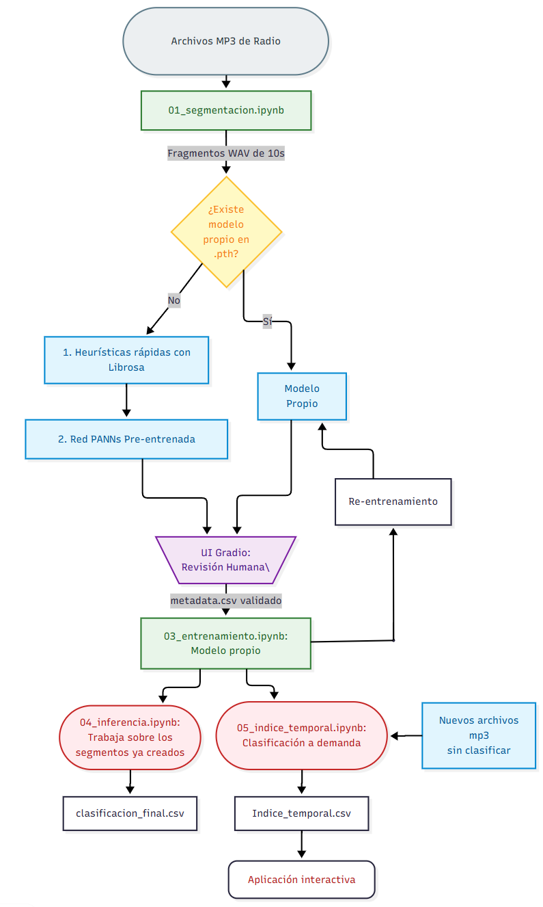
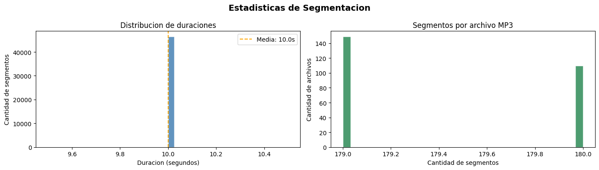
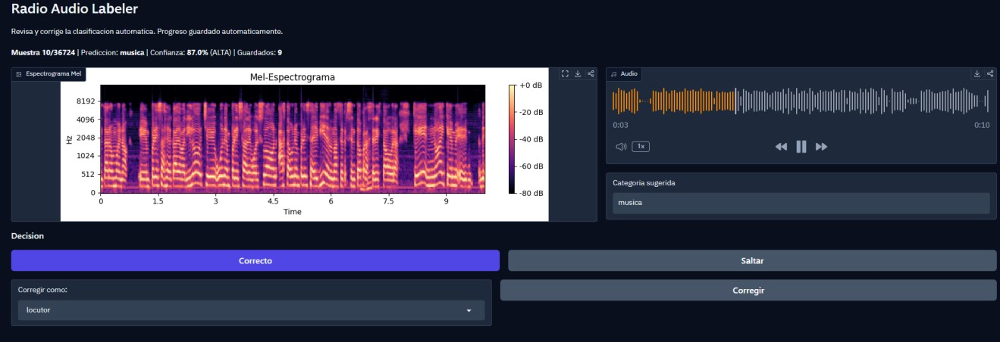

# Clasificador por Segmento de Audio para Radio Nacional 📻

**Universidad Nacional de Río Negro (UNRN)**  
**Materia:** Inteligencia Artificial (2026)  
**Alumno:** Andrés Koszutski  

---

## 📖 El Problema

Actualmente, la estación de Radio Nacional de Bariloche cuenta con una enorme biblioteca de audio (casi 9 GB provistos para la prueba inicial, con un histórico de decenas de TB). Estas grabaciones son continuas, sin cortes y no están indexadas (conocidas como "cinta testigo"). Quedan de fondo grabando todo lo transmitido sin discriminar por programa, publicidad, música, etc.

Se busca armar un catálogo digital organizado para poder acceder a la historia de la radio desde un índice, permitiendo recuperar valiosas entrevistas y noticias, y descartando contenido no histórico.

 *(Nota: Reemplaza con la imagen de los discos duros y TBs del PDF)*

## 💡 La Solución

Para evitar incontables horas humanas de indexación, se implementa una solución de **Inteligencia Artificial** que clasifica el audio de forma autónoma. 

El sistema segmenta el audio en fragmentos de **10 segundos** y genera un índice (`.csv` o `.xlsx`) donde cada fragmento se asocia a una categoría (Ej: $0$ = música, $1$ = Deporte, $2$ = Entrevista). Esto sienta las bases para un futuro software visual interactivo.

---

## ⚙️ Flujo de Trabajo y Componentes

El proyecto está estructurado en 5 etapas principales (Notebooks):

 *(Nota: Reemplaza con el diagrama de flujo del PDF)*

### 1. Adecuación de los datos (`01_segmentacion.ipynb`)
Convierte la información cruda (MP3/WAV) en fragmentos de 10 segundos.
*   **Por qué 10 segundos:** Es raro que el contenido cambie de categoría en menos tiempo.
*   **Rendimiento:** Utiliza procesamiento *Multithreaded* para acelerar la escritura en discos SSD/NVMe.

### 2. Etiquetado (`02_etiquetado.ipynb`)
Clasificación inicial y validación humana del dataset.
*   **Pre-etiquetado heurístico:** Uso de `Librosa` para diferenciar música/ruido.
*   **Pre-etiquetado con Deep Learning:** Uso de **PANNs** (Pretrained Audio Neural Networks, modelo CNN14 entrenado con AudioSet) para un reconocimiento de patrones de sonido avanzado.
*   **Etiquetado Humano (Gradio):** Interfaz web interactiva proporcionada al personal de la radio para corregir y validar etiquetas con un 100% de confianza.

### 3. Entrenamiento (`03_entrenamiento.ipynb`)
Entrenamiento del modelo clasificador propio.
*   **Transformación:** Los audios se convierten en **Espectrogramas Mel** (imágenes de 224x224 que representan el audio en escala perceptual Log-Mel).
*   **Modelo:** Utiliza **EfficientNet-B0** (vía la librería `timm` de PyTorch), escalado equilibradamente para alto rendimiento con pocos parámetros (~4M).
*   **Transfer Learning:** Entrenamiento de la capa final (Fine-tuning) congelando el backbone inicial, permitiendo re-entrenamiento continuo al sumar datos validados por humanos.

### 4. Inferencia (`04_inferencia.ipynb`)
Ejecución masiva (Batch Inference) sobre todo el dataset.
*   Respeta las etiquetas manuales previas.
*   Aplica un **umbral de confianza (50%)**. Muestras por debajo del umbral se marcan como `indefinido` para forzar futuras revisiones humanas y re-entrenamientos.

### 5. Índice Temporal (`05_indice_temporal.ipynb`)
Construcción de la línea de tiempo estructurada (timeline) final.
*   **Procesamiento In-Memory:** Procesa directamente el MP3 sin generar archivos WAV intermedios.
*   **Mecanismo Híbrido (Fallback):** Si el modelo principal falla, utiliza heurísticas de respaldo.
*   **Tolerancia a Fallos:** Checkpoints automáticos para reanudar tareas masivas ante cortes.
*   **Salida:** `indice_temporal.csv` con trazabilidad absoluta (Timestamp, Categoría, Confianza).

---

## 🚀 Salidas y Casos de Uso

1.  **Recuperación Histórica:** Facilitar el acceso a registros de la radio.
2.  **Auditoría y Estrategia:** Reconstruir grillas horarias, medir tiempos de pauta comercial y segmentación de programas.
3.  **Visualizador Interactivo (Trabajo Futuro):** Desarrollo de una UI que consuma el `indice_temporal.csv` para mostrar una barra de tiempo interactiva donde se pueda hacer clic y reproducir/cortar el segmento de audio.

 *(Nota: Reemplaza con la imagen de la línea de tiempo del PDF)*
