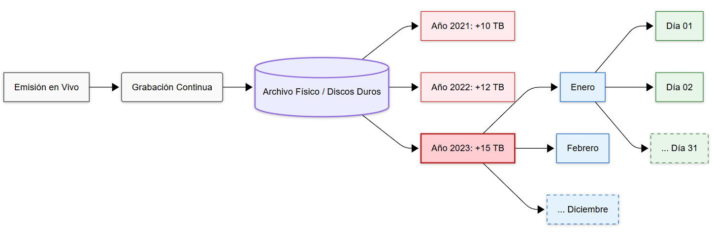
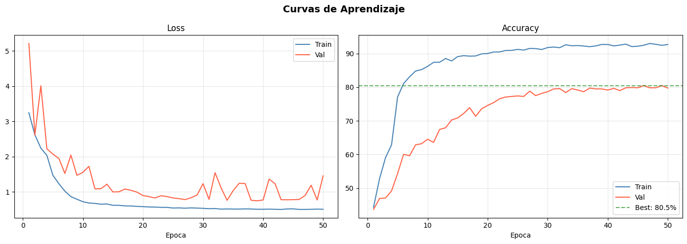
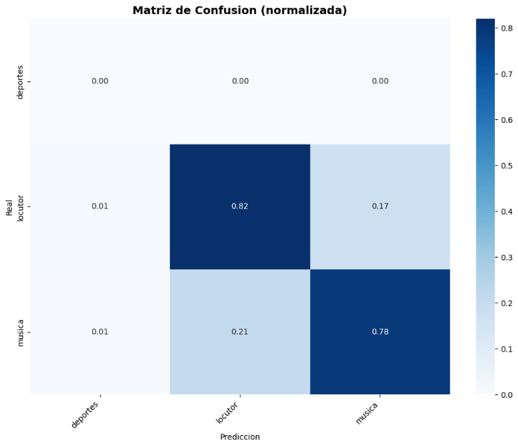
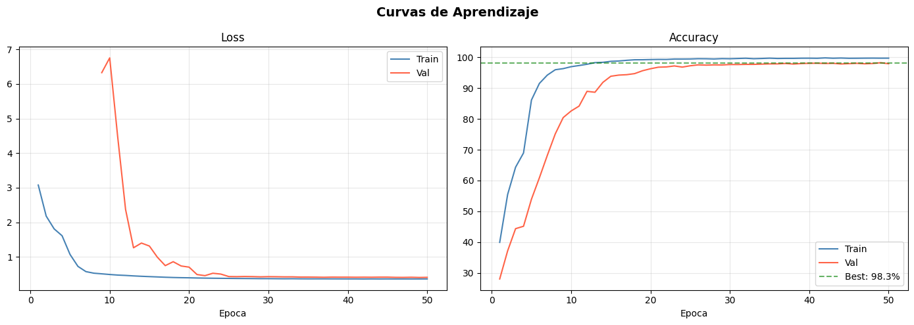
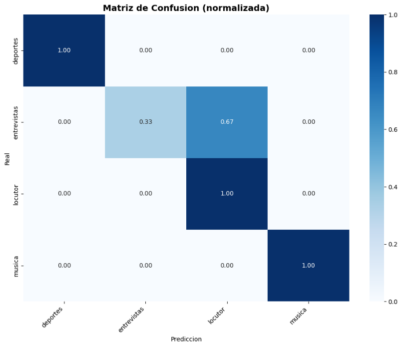
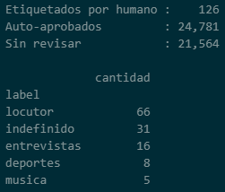
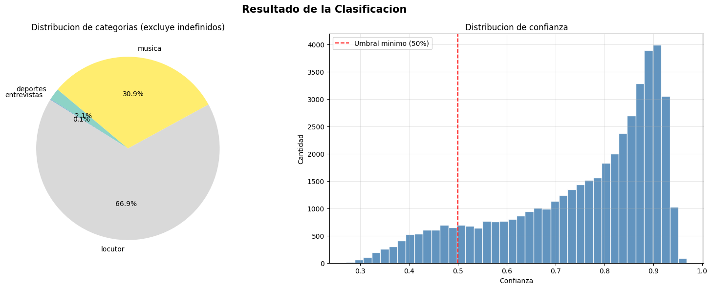
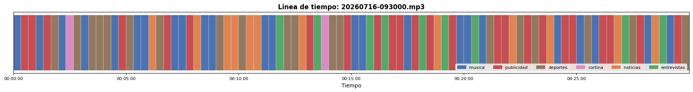

# Clasificador por Segmento de Audio para Radio Nacional 📻

**Universidad Nacional de Río Negro (UNRN)**  
**Materia:** Inteligencia Artificial (2026)  
**Docente:** Federico Tula  
**Alumno:** Andrés Koszutski  
**Fecha:** 14 de Julio de 2026  

---

## 📋 Resumen del Proyecto

Este repositorio contiene el desarrollo e implementación de un sistema de Inteligencia Artificial para la catalogación, segmentación y clasificación automática de las grabaciones continuas de **Radio Nacional Bariloche**.

El sistema procesa archivos masivos de audio ("cintas testigo") sin cortes, subdividiéndolos en bloques de 10 segundos, extrayendo características acústicas mediante **Espectrogramas Mel** y clasificándolos en categorías como **música, locutor, entrevistas, deportes, publicidad y cortinas** a través de modelos de Deep Learning basados en **EfficientNet-B0**, redes pre-entrenadas **PANNs (CNN14)**, heurísticas espectrales y una interfaz interactiva de etiquetado humano construida con **Gradio**.

---

## 📖 El Problema

Actualmente, la estación de **Radio Nacional de Bariloche** cuenta con una biblioteca histórica de miles de horas de audio continuo en formato MP3/WAV. Estas emisiones se graban ininterrumpidamente sin cortes de programación y sin metadatos asociados (lo que se conoce en la industria como *cinta testigo*).



Almacenar decenas de Terabytes año a año dificulta enormemente:
*   Localizar entrevistas o noticias de relevancia histórica.
*   Distinguir el contenido editorial de música, tanda publicitaria o cortinas institucionales.
*   Reconstruir la grilla horaria emitida o auditar pautas comerciales de manera manual, lo cual requeriría incontables horas humanas inviables operativamente.

---

## 💡 La Solución Propuesta

Se diseñó un flujo integral de IA capaz de cribar miles de horas de forma autónoma:
1.  **Segmentación temporal fija (10 segundos):** Se elige esta ventana porque en la dinámica radial es poco común que el contenido cambie de categoría en un intervalo menor. Si conviven varios tipos, se categoriza como `indefinido`.
2.  **Generación de Índices Estructurados:** Generación de archivos tabulares (`CSV` y `Excel`) donde cada segmento temporal tiene asignada una categoría, porcentaje de confianza y timestamp exacto (`HH:MM:SS`).
3.  **Visualizador Interactivo:** Conversión del índice a una barra temporal segmentada por colores que permite navegar la emisión y reproducir/extraer fragmentos específicos.

---

## 🗺️ Diagrama de Procesamiento

El flujo general del pipeline y la interacción entre notebooks se resume en el siguiente esquema:


---

## 📁 Estructura del Repositorio

```text
├── images/                             # Diagramas, capturas y gráficos del informe
│   ├── problema_archivo_historico.png
│   ├── diagrama_procesamiento.png
│   ├── estadisticas_segmentacion.png
│   ├── interfaz_gradio.png
│   ├── flujo_espectrograma_mel.png
│   ├── curvas_panns_100.png
│   ├── confusion_panns_100.png
│   ├── resumen_etiquetado_humano.png
│   ├── curvas_reentrenamiento_humano.png
│   ├── confusion_reentrenamiento_humano.png
│   ├── resultado_inferencia.png
│   └── linea_tiempo_cinta_testigo.png
├── radio_classifier/                   # Módulos y Notebooks de procesamiento
│   ├── 01_segmentacion.ipynb           # Notebook 1: Segmentación inteligente de MP3 a WAV
│   ├── 02_etiquetado.ipynb             # Notebook 2: Pre-clasificación (PANNs/Librosa) y UI Gradio
│   ├── 03_entrenamiento.ipynb          # Notebook 3: Entrenamiento EfficientNet-B0 con Mel Spectrograms
│   ├── 04_inferencia.ipynb             # Notebook 4: Inferencia masiva sobre el dataset
│   ├── 05_indice_temporal.ipynb        # Notebook 5: Generación de timeline continuo in-memory
│   ├── _segmentacion_worker.py         # Worker multiproceso para corte de audio y detección de silencios
│   ├── _heur_worker.py                 # Worker para cálculo espectral rápido con Librosa
│   └── requirements.txt                # Dependencias del proyecto
└── README.md                           # Documentación principal del repositorio
```

---

## 🛠️ Requisitos e Instalación

### 1. Entorno de Python
Se recomienda utilizar **Python 3.10** o **Python 3.11** (64-bit).

Crear y activar un entorno virtual:
```bash
# En Windows (PowerShell)
python -m venv venv
.\venv\Scripts\Activate.ps1
```

### 2. Instalación de Dependencias
Instalar las librerías listadas en [requirements.txt](file:///c:/repo/IA/radio_classifier/requirements.txt):
```bash
pip install --upgrade pip
pip install -r radio_classifier/requirements.txt
```

> **Aceleración GPU (Opcional pero recomendada):**  
> Para aprovechar CUDA durante el entrenamiento e inferencia con PyTorch, instalar la variante compatible según tu GPU desde [PyTorch.org](https://pytorch.org):
> ```bash
> pip install torch torchvision torchaudio --index-url https://download.pytorch.org/whl/cu121
> ```

### 3. Instalación de FFmpeg
El pipeline de segmentación y lectura de audio utiliza **FFmpeg** y **FFprobe** de manera intensiva:
*   En Windows, se puede instalar vía WinGet:
    ```powershell
    winget install Gyan.FFmpeg
    ```
*   O descargarlo manualmente y asegurarse de configurar la variable `FFMPEG_BIN` en la celda 1 de [01_segmentacion.ipynb](file:///c:/repo/IA/radio_classifier/01_segmentacion.ipynb) y [05_indice_temporal.ipynb](file:///c:/repo/IA/radio_classifier/05_indice_temporal.ipynb) con la ruta correspondiente a la carpeta `bin`.

### 4. Estructura de Carpetas de Trabajo
Por defecto, los notebooks trabajan sobre un directorio rápido (idealmente SSD o NVMe) para almacenar temporales y modelos:
```text
C:\temporales\
├── segmentos\          # Fragmentos WAV generados en el paso 1
├── modelos\            # Checkpoints .pth y métricas de entrenamiento
├── metadata.csv        # Registro de segmentos y anotaciones
└── clasificacion_final.xlsx / indice_temporal.csv
```

---

## 🚀 Guía de Uso Paso a Paso

El sistema se ejecuta secuencialmente a través de 5 notebooks interactivos ubicados en la carpeta `radio_classifier/`:

---

### Paso 1: Adecuación y Segmentación de Datos (`01_segmentacion.ipynb`)

El notebook [01_segmentacion.ipynb](file:///c:/repo/IA/radio_classifier/01_segmentacion.ipynb) realiza la ingesta masiva de grabaciones en bruto (`.mp3` de cualquier duración) y las divide en fragmentos homogéneos de 10 segundos cortando en silencios naturales.

*   **Multithreaded / Multiproceso:** Para evitar agotar la memoria RAM con archivos de 20+ horas, procesa el audio en chunks de 10 minutos vía pipes de FFmpeg y paraleliza la exportación de fragmentos WAV con [procesar_mp3_worker](file:///c:/repo/IA/radio_classifier/_segmentacion_worker.py#L83-L166).
*   **Resume Mode:** Puede detenerse y retomarse en cualquier momento sin duplicar cómputo gracias al registro de archivos en `metadata.csv`.
*   **Dataset Inicial:** Radio Nacional Bariloche cooperó con ~9 GB de audio (259 archivos MP3, 129.1 horas de audio, 46.471 segmentos de 10 segundos).


---

### Paso 2: Etiquetado Híbrido y Validación Humana (`02_etiquetado.ipynb`)

El notebook [02_etiquetado.ipynb](file:///c:/repo/IA/radio_classifier/02_etiquetado.ipynb) combina pre-clasificación algorítmica con revisión humana interactiva:

1.  **Pre-etiquetado con Heurísticas Espectrales:** Mediante [extract_and_classify](file:///c:/repo/IA/radio_classifier/_heur_worker.py#L7-L82), evalúa métricas matemáticas de audio con Librosa:
    *   *Flatness Espectral:* Distingue sonidos tonales/armónicos (música) frente a ruidosos/hablados.
    *   *Zero Crossing Rate (ZCR):* Tasa de cruce por cero para detectar sibilancias y voces.
    *   *Chroma STFT y Centroide Espectral:* Identifica riqueza tímbrica musical.
2.  **Pre-etiquetado con PANNs (CNN14):** Utiliza la red neuronal convolucional pre-entrenada por la Universidad de Surrey sobre **Google AudioSet** (5.000+ horas de audio, 527 categorías acústicas). Mapea clases de AudioSet hacia las clases del proyecto (`musica`, `locutor`, etc.).
3.  **Etiquetado Humano Asistido con Gradio:** Lanza una interfaz web local donde operadores de la radio pueden escuchar fragmentos ordenados de menor a mayor confianza, ver el espectrograma en tiempo real, confirmar o corregir la etiqueta, y agregar nuevas categorías (por ejemplo, nombres de locutores específicos).


> **Criterio de Preservación:** Todo segmento validado por un operador humano se guarda con `label_fuente = 'humano'` y una confianza de 1.0 (100%). **Nunca es sobrescrito** por procesos heurísticos ni por el modelo en futuras iteraciones.

---

### Paso 3: Entrenamiento del Modelo Propio (`03_entrenamiento.ipynb`)

El notebook [03_entrenamiento.ipynb](file:///c:/repo/IA/radio_classifier/03_entrenamiento.ipynb) entrena una red neuronal convolucional propia adaptada a las características sonoras de la emisora.

#### Transformación a Espectrogramas Mel
Convierte cada segmento de audio en una imagen de 3 canales y resolución **224×224 píxeles**:


*   **STFT (Short-Time Fourier Transform):** Ventaneo y espectro lineal de frecuencias.
*   **Banco de Filtros Mel:** Escala no lineal que imita la resolución auditiva humana (mayor resolución en bajas frecuencias).
*   **Escala Logarítmica (dB):** Ajusta amplitudes a decibelios perceptuales.

#### Arquitectura: EfficientNet-B0
Se utiliza **EfficientNet-B0** mediante la librería `timm` (`timm.create_model('efficientnet_b0', pretrained=True)`):
*   Aprovecha el **escalado compuesto (Compound Scaling)** equilibrando profundidad, ancho de canales y resolución.
*   Cuenta con solo **~4 millones de parámetros** (frente a los ~25M de una ResNet-50), lo que permite inferencias y entrenamientos ultrarrápidos.
*   **Transfer Learning (Warm-up + Fine-tuning):** En las primeras épocas se congela el *backbone* entrenado con ImageNet y solo se optimiza la cabeza lineal clasificadora; luego se descongela progresivamente con tasa de aprendizaje reducida (`AdamW` + `CosineAnnealingLR`).

#### Comparativa de Resultados

| Escenario | Curvas de Aprendizaje | Matriz de Confusión |
| :--- | :---: | :---: |
| **Entrenamiento 100% PANNs**<br>*(Sin supervisión humana)* |  |  |
| **Re-entrenamiento con intervención humana**<br>*(126 muestras manuales sumadas al modelo)* |  |  |



*   **Impacto de la intervención humana:** Con tan solo 126 muestras curadas manualmente por operadores de la emisora, la precisión en validación saltó al **98.3%**, resolviendo confusiones entre entrevistados telefónicos, locución de cabina y música.

---

### Paso 4: Inferencia Masiva y Exportación (`04_inferencia.ipynb`)

El notebook [04_inferencia.ipynb](file:///c:/repo/IA/radio_classifier/04_inferencia.ipynb) ejecuta inferencia en lote (*Batch Inference*) sobre el 100% de los segmentos de audio de la biblioteca:

*   **Preservación de datos manuales:** Respeta `SOBREESCRIBIR_HUMANOS = False`, evaluando únicamente segmentos pendientes.
*   **Filtro por Incertidumbre:** Se fija un umbral de confianza mínimo del 50% (`MIN_CONFIDENCE = 0.50`). Aquellos segmentos cuya predicción sea inferior al 50% se categorizan de forma segura como `indefinido`.
*   **Exportación de Resultados:** Guarda la clasificación completa en `clasificacion_final.csv` y en un archivo de Excel estilizado `clasificacion_final.xlsx`.



---

### Paso 5: Generación del Índice Temporal In-Memory (`05_indice_temporal.ipynb`)

El notebook [05_indice_temporal.ipynb](file:///c:/repo/IA/radio_classifier/05_indice_temporal.ipynb) procesa emisiones continuas directamente a partir de los archivos de emisión original (cintas testigo de varias horas) para generar un mapa temporal estructurado (*timeline*):

*   **Procesamiento In-Memory sin I/O en disco:** Lee el archivo MP3 mediante streams en memoria y extrae los espectrogramas directamente, sin necesidad de guardar miles de archivos `.wav` intermedios.
*   **Particionamiento Temporal Fijo:** Segmenta la señal en bloques configurables de 10 segundos (`BLOCK_S = 10`), garantizando una grilla horaria homogénea.
*   **Mecanismo Híbrido de Fallback:**
    *   *Vía Principal:* Modelo `EfficientNet-B0` entrenado (`clasificador_radio_v1.pth`).
    *   *Vía de Respaldo:* Si la confianza es insuficiente o el modelo no está disponible, conmuta a PANNs AudioSet CNN14 o heurísticas espectrales.
*   **Tolerancia a Fallos (Checkpoints):** Realiza guardados automáticos de progreso cada 50 archivos (`CHECKPOINT_N = 50`), permitiendo suspender y reanudar procesamientos masivos sin duplicar cómputo.
*   **Salida de Trazabilidad:** Genera `indice_temporal.csv` con nombre de archivo, número de bloque, timestamps exactos de inicio y fin (`HH:MM:SS`), etiqueta asignada y nivel de confianza.

---

## 📊 Visualizador Interactivo de Emisión

A partir del archivo `indice_temporal.csv`, el notebook genera una representación visual tipo barra horizontal segmentada por colores según el tipo de contenido transmitido:



### Aplicación Futura:
Este índice habilita el desarrollo de una interfaz de usuario interactiva (web o desktop) donde el personal de la radio o investigadores puedan:
1.  Ver la línea de tiempo completa del día.
2.  Hacer clic en cualquier bloque de color (ej. un segmento verde de entrevista o marrón de deportes).
3.  Reproducir instantáneamente el audio a partir de ese timestamp exacto.
4.  Exportar o descargar clips recortados del segmento deseado.

---

## 🎯 Casos de Uso y Aplicación en Radio Nacional

1.  **Recuperación del Archivo Histórico:** Búsqueda rápida de testimonios, personalidades y eventos relevantes sin tener que reproducir cintas completas de días enteros.
2.  **Auditoría y Certificación de Pauta Comercial:** Medición automática y exacta de segundos de publicidad emitida por franja horaria.
3.  **Reconstrucción Estratégica de la Grilla:** Análisis estadístico de los porcentajes reales de tiempo dedicados a música, noticias, opinión o deportes a lo largo de los meses.

---

## 👥 Créditos y Autoría

*   **Autor:** Andrés Koszutski ([GitHub](https://github.com/andres-kos))
*   **Cátedra:** Inteligencia Artificial (2026) - Universidad Nacional de Río Negro (UNRN)
*   **Docente:** Federico Tula
*   **Colaboración:** Radio Nacional Bariloche (material sonoro de cinta testigo).
